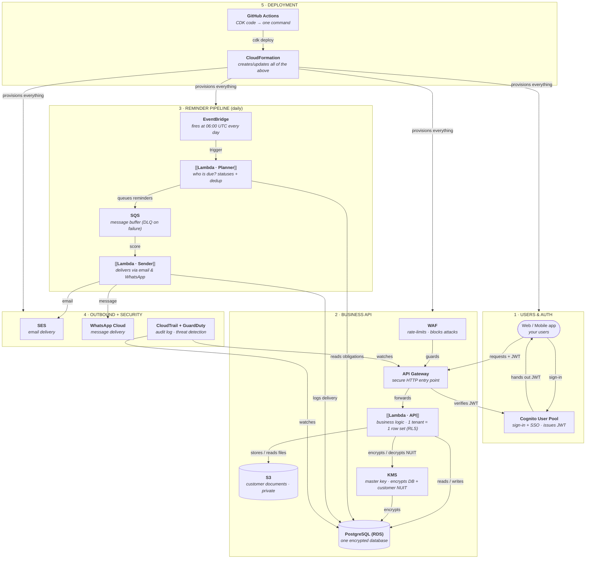

# CLAQ Fiscal Alert — demo backend, simplified architecture

Companion to the full diagram in [`ARCHITECTURE.md`](./ARCHITECTURE.md). Source:
[`architecture-simple.mmd`](./architecture-simple.mmd); renders to
[`architecture-simple.png`](./architecture-simple.png) (3136×2984) and
`architecture-simple.svg` (for PowerPoint).

## Diagram

## What each AWS service is for (say this to your teachers)

| # | AWS service | One-line purpose | Where it lives in code |
|---|-------------|------------------|------------------------|
| 1 | **Cognito** | Sign-in + Google/Microsoft/Apple SSO; issues the JWT the API trusts | `infra/stack.ts:42` |
| 2 | **WAF** | Front door filter: rate-limit and SQL-injection/attack rules before a request reaches the API | `infra/stack.ts:200` |
| 3 | **API Gateway** | The only public endpoint; forwards calls to a Lambda and enforces the JWT | `infra/stack.ts:154` |
| 4 | **Lambda · API** | All business logic (obligations, simulators, plans) with tenant isolation enforceable per request | `src/router.ts`, `src/lib/tenant.ts` |
| 5 | **PostgreSQL (RDS)** | The single database; encrypted, private subnet, Row-Level Security per tenant | `infra/foundation.ts:71`, `prisma/migrations/0002_tenant_rls` |
| 6 | **S3** | Private storage for customer documents | `infra/foundation.ts:49` |
| 7 | **KMS** | Master key: encrypts the database and the customer's tax id (NUIT) before storage | `infra/foundation.ts:43`, `src/lib/crypto.ts` |
| 8 | **EventBridge** | A daily clock that fires the reminder job at 06:00 UTC | `infra/stack.ts:168` |
| 9 | **Lambda · Planner** | Decides who is notified today: syncs obligation status, dedups lead days | `src/workers/reminders.ts` |
| 10 | **SQS** | A buffer so a busy email system can't slow down or block the planner; failed messages go to a DLQ | `infra/foundation.ts:68` |
| 11 | **Lambda · Sender** | Pulls from the queue and delivers each reminder | `src/workers/notifier.ts` |
| 12 | **SES** | Email delivery for reminders | `infra/stack.ts:182` |
| 13 | **WhatsApp Cloud** | Optional WhatsApp delivery of reminders | `infra/stack.ts:180` |
| 14 | **CloudTrail + GuardDuty** | Audit log of every cloud action + threat detection | `infra/stack.ts:236` |
| 15 | **GitHub Actions + CloudFormation** | Every resource above is *declared in code* and created by one command | `.github/workflows/deploy.yml` |

## The 3-minute walkthrough (matching the diagram lanes)

1. **Users & Auth** — people sign in through Cognito (with Google/Microsoft/Apple), the app gets a JWT, and every request shows it to API Gateway.
2. **Business API** — API Gateway forwards to the API Lambda; that Lambda reads/writes PostgreSQL where Row-Level Security means each tenant can only ever see its own rows, and never in plain sight: tax IDs are sealed by KMS.
3. **Reminder pipeline** — EventBridge wakes the planner daily; it computes who is due and puts the work in SQS; the sender Lambda consumes it and emails (SES) or WhatsApps (Meta Cloud).
4. **Outbound + security** — CloudTrail and GuardDuty watch everything from the outside.
5. **Deployment** — all of this is TypeScript/CDK code, so "provision the whole architecture" is literally `npm run deploy:demo`.