# CLAQ Fiscal Alert — demo environment architecture

Standalone diagram source: [`architecture.mmd`](./architecture.mmd) — paste it into
[mermaid.live](https://mermaid.live/) and export SVG/PNG for slides. GitHub and VS Code
render `.md` and `.mmd` directly.

## Diagram

```mermaid
flowchart TB
    subgraph CLIENTS["CLIENTS"]
        Web(["<b>Web app</b><br/>SSL · app.claq.co.mz / localhost:3000"])
        Mobile(["<b>Mobile app</b><br/>future target · same API"])
        Ops(["<b>Administrator (tribe)</b><br/>creates Cognito users · no self sign-up"])
    end

    subgraph IDP["IDENTITY PROVIDERS (SSO)"]
        Google["Google"]
        MSFT["Microsoft Azure AD (OIDC)"]
        Apple["Apple Sign-In"]
    end

    subgraph AWS["AWS ACCOUNT — demo: 794813216328 · af-south-1 · cdk stack <b>claq-demo</b>"]
        direction TB
        subgraph VPC["VPC (max 2 AZs · 3 subnet tiers /24)"]
            direction TB
            subgraph PUBLICSUBNETS["public subnets"]
                NAT["NAT Gateway (1 in demo · 2 in prod)"]
                InternetGW["Internet Gateway"]
            end
            subgraph APPSUBNETS["app subnets (PRIVATE_WITH_EGRESS)"]
                AppSG["<b>Application Security Group</b>"]
                ApiFn["[[<b>ApiFunction</b> Lambda]]<br/>512 MB · 28s · X-Ray · Prisma + RLS tenant guard<br/><i>src/router.ts</i>"]
                RemFn["[[<b>RemindersFunction</b> Lambda]]<br/>512 MB · 5 min · daily planner<br/><i>src/workers/reminders.ts</i>"]
                NotifFn["[[<b>NotifierFunction</b> Lambda]]<br/>256 MB · 60s · SES + WhatsApp<br/><i>src/workers/notifier.ts</i>"]
                MigFn["[[<b>MigrationsRunner</b> Lambda]]<br/>custom resource · 5 min<br/><i>src/workers/migrator.ts</i>"]
            end
            subgraph DBSUBNETS["db subnets (PRIVATE_ISOLATED · no internet)"]
                DBSG["Database Security Group<br/>allow TCP 5432 ← only App SG"]
                RDS[("RDS PostgreSQL 16<br/>T4G.MICRO demo · multi-AZ in prod<br/>KMS-encrypted · backups 7d demo / 35d prod<br/>deletion protection off demo / on prod<br/>secret in Secrets Manager")]
            end
        end

        APIGW["<b>API Gateway HTTP API</b><br/>GET /v1/health · POST /v1/billing/webhook · public<br/>/v1/{proxy+} · Cognito JWT authorizer"]
        WEBACL["WAF WebACL<br/>2,000 req/IP rate limit<br/>AWS managed rules: Common + SQLi<br/><i>(created — associate in prod)</i>"]
        COGNITO["<b>Cognito User Pool</b><br/>email alias · no self sign-up · optional TOTP MFA<br/>password ≥12 · Google/MS/Azure/Apple IdPs<br/>domain prefix: demo-auth"]
        EVENTS["EventBridge rule<br/>cron 0 6 * * ? · 06:00 UTC retry×2"]
        SQSQ["SQS <b>Notifications</b><br/>70s visibility · SQS-KMS · sends→Api/Reminders<br/>consume←Notifier (batch 10 · partial-failure reporting)"]
        SQSDLQ["SQS <b>DLQ</b><br/>maxReceive 3 · 14 days retention"]
        S3_DOCS[("S3 <b>documents</b><br/>private · versioned · enforceSSL · SSE-S3")]
        S3_TRAIL[("S3 <b>trail logs</b><br/>private · versioned · lifecycle 30d demo / 365d prod")]
        KMS["KMS CMK <b>claq-demo-data</b><br/>automatic rotation · encrypts RDS + NUIT field"]
        SECRETS["Secrets Manager<br/>RDS admin creds · WhatsApp token · Stripe keys"]
        CLOUDTRAIL["CloudTrail<br/>multi-region management trail"]
        CWLOGS["CloudWatch Logs + X-Ray<br/>retention 30d demo / 365d prod"]
        GUARDDUTY["GuardDuty<br/>findings every 15 min"]
        SECURITYHUB["Security Hub<br/>auto-enabled controls"]

        RESTMIGRANT["CloudFormation custom resource<br/><b>Custom::ClaqDatabaseMigration</b><br/>keyed on hash of prisma/migrations SQL"]
    end

    subgraph SAAS["EXTERNAL SERVICES"]
        STRIPE["Stripe<br/>subscriptions · invoices · webhooks"]
        SES["Amazon SES<br/>alert emails"]
        WHATSAPP["Meta WhatsApp Cloud API<br/>obligation reminders"]
    end

    subgraph CICD["CI / CD — GitHub Actions"]
        VERIFY["verify (on PR)<br/>npm ci · lint · build · test · cdk synth"]
        DEPLOY["deploy (main / manual)<br/>OIDC role assume (no static keys)<br/>GitHub environment demo / prod<br/>prod requires reviewers"]
        CFN["AWS CloudFormation<br/>CDK synth → template"]
    end

    %% ---------- Auth flow ----------
    Web -->|"GET/POST JSON · Bearer JWT"| APIGW
    Mobile -->|"GET/POST JSON · Bearer JWT"| APIGW
    Ops -->|"admin console"| COGNITO
    Web -->|"OAuth2 authorize-code"| COGNITO
    Mobile -->|"OAuth2 authorize-code"| COGNITO
    COGNITO -->|"federated IdPs"| Google
    COGNITO -->|"federated IdPs"| MSFT
    COGNITO -->|"federated IdPs"| Apple
    APIGW -.->|"JWT audience + issuer check"| COGNITO

    %% ---------- API path ----------
    APIGW -->|"proxy /v1/{proxy+}"| ApiFn
    WEBACL -.->|"rate + SQLi/WAF rules"| APIGW
    ApiFn -->|"Prisma SQL · set_config('app.tenant_id') · RLS"| RDS
    ApiFn -->|"seal / unseal NUIT (ciphertext at rest)"| KMS
    ApiFn -->|"documents (short-lived URLs)"| S3_DOCS
    ApiFn -->|"reminder/notification requests"| SQSQ
    ApiFn -->|"checkout session · status"| STRIPE
    STRIPE -->|"signed webhook POST"| APIGW
    ApiFn -->|"secrets via ARN"| SECRETS

    %% ---------- Reminder pipeline ----------
    EVENTS -->|"trigger daily 06:00 UTC"| RemFn
    RemFn -->|"sync UPCOMING/DUE/OVERDUE · lead-day dedup"| RDS
    RemFn -->|"enqueue"| SQSQ
    SQSQ -.->|"exhausted retries"| SQSDLQ
    NotifFn -->|"EventSourceMapping consume · partial failures"| SQSQ
    NotifFn -->|"ses:SendEmail"| SES
    NotifFn -->|"POST message"| WHATSAPP
    NotifFn -->|"WhatsApp token"| SECRETS

    %% ---------- Migrations ----------
    RESTMIGRANT -->|"on deploy"| MigFn
    MigFn -->|"apply prisma/migrations SQL (hashing)"| RDS

    %% ---------- Observability / security ----------
    CLOUDTRAIL -->|"management events"| S3_TRAIL
    CLOUDTRAIL -->|"events"| CWLOGS
    ApiFn -->|"logs · traces"| CWLOGS
    RemFn -->|"logs · traces"| CWLOGS
    NotifFn -->|"logs · traces"| CWLOGS
    RDS -.->|"monitored"| GUARDDUTY
    APIGW -.->|"monitored"| GUARDDUTY
    APIGW -.->|"compliance findings"| SECURITYHUB
    RDS -.->|"compliance findings"| SECURITYHUB

    %% ---------- CI/CD ----------
    DEPLOY -->|"OIDC assume AWS_DEPLOY_ROLE_ARN"| CFN
    CFN -->|"provision / update"| AWS
    VERIFY -.->|"quality gates pass before merge"| DEPLOY
```

## Resource legend

Every labeled node, where it is declared, and the one-line story to tell about it.

| # | Resource | Declared in | The story |
|---|----------|-------------|-----------|
| 1 | VPC (public / app / isolated-db, /24) | `infra/foundation.ts:27` | 3-tier network; the database sits in subnets with no route to the internet |
| 2 | NAT Gateway (1 demo / 2 prod) | `infra/foundation.ts:30` | only app-tier Lambdas get outbound internet; DB and S3-tenant docs stay private |
| 3 | Application Security Group | `infra/foundation.ts:39` | shared identity for the Lambda tier |
| 4 | Database Security Group (5432 ← App SG only) | `infra/foundation.ts:40` | one ingress rule, scoped to the app SG — nobody else can reach the DB |
| 5 | RDS PostgreSQL 16 | `infra/foundation.ts:71` | T4G.MICRO in demo vs multi-AZ LARGE in prod; storage-encrypted with the CMK; backups 7d/35d; deletion protection off/on — a copy of the guardrail diff you show from `config/*.json` |
| 6 | KMS CMK `claq-demo-data` | `infra/foundation.ts:43` | auto-rotation key; encrypts RDS at rest and the NUIT field |
| 7 | S3 `documents` (private, versioned, SSL) | `infra/foundation.ts:49` | tenant documents; `BlockPublicAccess.BLOCK_ALL`, `enforceSSL` |
| 8 | S3 `trail logs` (private, versioned, lifecycle) | `infra/foundation.ts:58` | CloudTrail sink; 30d/365d expiry |
| 9 | SQS `Notifications` + DLQ | `infra/foundation.ts:68` | decoupling for the reminder pipeline; DLQ `maxReceiveCount: 3` |
| 10 | Cognito User Pool + OAuth client | `infra/stack.ts:42` | no self sign-up, optional TOTP MFA, 12-char password policy, auth-code flow |
| 11 | Google / Microsoft / Apple IdPs | `infra/stack.ts:65` | federated SSO, each behind a config flag (`config/*.json`) |
| 12 | API Gateway HTTP API + JWT authorizer | `infra/stack.ts:154` | `/v1/health` and `/v1/billing/webhook` public; everything else requires a Cognito JWT |
| 13 | WAF WebACL (rate + managed rules) | `infra/stack.ts:200` | 2 000 req/IP/min + AWS Common + SQLi rule sets |
| 14 | ApiFunction | `infra/stack.ts:135` | the whole RLS-guarded API, `src/router.ts`; env gets bucket/queue/CMK ids |
| 15 | RemindersFunction + EventBridge rule | `infra/stack.ts:161` | cron 06:00 UTC; status sync + per-tenant lead-day dedup |
| 16 | NotifierFunction + EventSourceMapping | `infra/stack.ts:174` | `batchSize: 10`, `reportBatchItemFailures: true`; SES + WhatsApp |
| 17 | MigrationsRunner + custom resource | `infra/stack.ts:118` | SQL applied on every deploy, keyed on `migrationsHash()` of `prisma/migrations` |
| 18 | CloudTrail | `infra/stack.ts:236` | multi-region management trail to S3 + CloudWatch |
| 19 | GuardDuty / Security Hub | `infra/stack.ts:245` | threat detection + CIS-aligned compliance dashboard |
| 20 | Stripe | `src/billing/webhook.ts` | signature-verified webhook; subscription + invoice sync |
| 21 | RLS (Company, Obligation, AuditEvent, NotificationSetting, NotificationAttempt, Simulation) | `prisma/migrations/0002_tenant_rls/migration.sql` | `FORCE ROW LEVEL SECURITY` = default-deny for the owner too |
| 22 | Tenant context | `src/lib/tenant.ts:19` | `set_config('app.tenant_id')` per transaction; `resolveTenant` never trusts the client header |
| 23 | KMS field sealing (NUIT) | `src/lib/crypto.ts:9` | tax id stored as ciphertext only; reveal is audited |
| 24 | Approved-rule engine | `src/rules.ts:32` | only `APPROVED` + sourced + reviewed + date-effective rules compute amounts |
| 25 | CI: `verify.yml` | `.github/workflows/verify.yml` | lint → typecheck → 54 tests → `cdk synth` on every PR |
| 26 | CD: `deploy.yml` | `.github/workflows/deploy.yml` | OIDC role assumption (no static keys); prod deployment requires reviewers |

## Reading order for the talk

1. **Slide 1** — the 3 bands on the left: Clients → API Gateway → ApiFunction. One sentence per layer.
2. **Slide 2** — zoom into the VPC (`foundation.ts`): why the DB is in isolated subnets + one SG ingress.
3. **Slide 3** — the reminder pipeline band: EventBridge → Reminders → SQS/DLQ → Notifier → SES/WhatsApp.
4. **Slide 4** — the observability/security band: CloudTrail/GuardDuty/Security Hub and RLS before anything else.
5. **Slide 5** — the CI/CD row at the bottom: `verify` gates, OIDC deploy, prod approval.