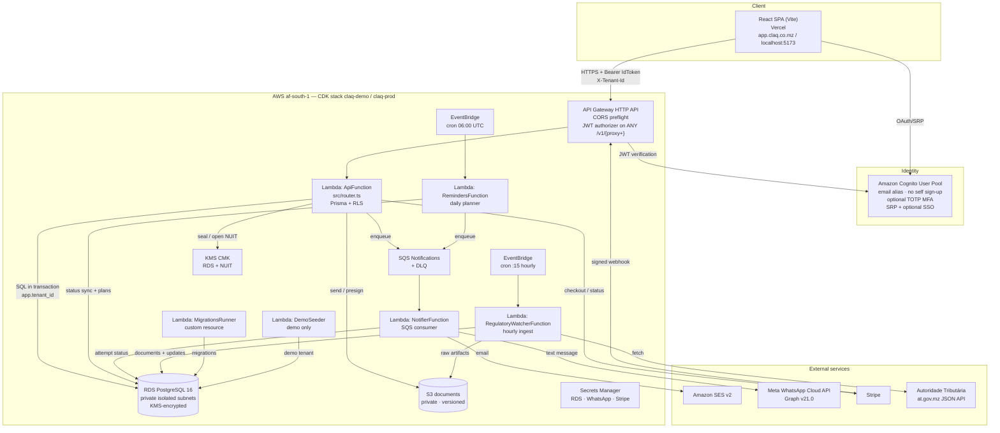
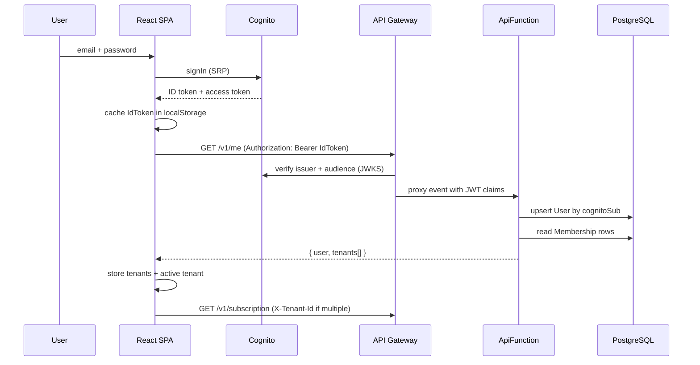

# CLAQ Fiscal Alert — Technical Components

**Document version:** 1.0  
**Date:** 22 October 2026  
**Backend inspected:** `CLAQ-FISCAL/claq-backend` branch `main`, commit `41ebf44` (working tree also contains commits `3f4ea3f` and `a773f10`)  
**Frontend inspected:** `CLAQ-FISCAL/CLAQ-FISCAL-WEB` branch working copy at `4e597d4` (`feat: wire frontend to backend (base URL, CORS, show all plans)`)  
**Scope:** end-to-end technical description of the system as implemented in source code.

> **Evidence rule used in this document.** Statements about behaviour come from reading the
> actual source files listed in section 11. Anything not implemented is labelled
> **Missing** or **Not implemented** rather than described as if it exists. No tax rates,
> deadlines or formulas are asserted here; they are loaded from the `RuleSet` table at runtime.

---

## 0. Legend

| Label | Meaning |
|---|---|
| **Implemented** | Present in code and reachable through a configured route or trigger |
| **Partial** | Present but with a known limitation, stub, or unused path |
| **Missing** | Referenced by the frontend, docs or a blueprint but absent from this backend |
| **Unused** | Implemented in the backend but not called by the current frontend |
| **Bug** | Verified code path that would fail or behave incorrectly |

---

## 1. Product surface

CLAQ Fiscal Alert is a multi-tenant fiscal-compliance platform for Mozambique with two audiences:

- **Accountants / accounting firms** managing a portfolio of client companies.
- **Companies ("Empresas")** managing their own obligations.

The implemented backend supports:

1. **Fiscal calendar and obligations** — obligations materialised from approved
   `OBLIGATION_TEMPLATE` rules, status maintenance, and a per-month calendar view.
2. **Alerts / reminders** — a daily planner plus an asynchronous notification pipeline
   (email, WhatsApp, in-app marker).
3. **Tax and labour simulators** — 13 deterministic calculators whose rates come from
   approved `RuleSet` content.
4. **Regulatory watch** — hourly ingestion of the Mozambican Tax Authority (AT) news feed
   into reviewable updates; never auto-applies rules.
5. **Plans and billing** — plan catalogue, limits, Stripe subscription/invoice sync.
6. **Security and audit** — Cognito authentication, per-tenant Row-Level Security, KMS
   encryption of the NUIT, and an audit trail.

The **frontend** additionally implements a large amount of client-side behaviour that does
not yet call this backend: local obligation/ alert/ simulation state, client-side tax
calculators, PDF generation, a static legal library, and a static official-gazette feed.
Section 6 maps that connection precisely.

---

## 2. Repositories and runtime topology

### 2.1 Three codebases, not two

| Codebase | Location | Role | Status |
|---|---|---|---|
| **Foundation backend** | `claq-backend` (this repository) | The authoritative server described in this document | Deployed to AWS `af-south-1` |
| **React frontend** | `CLAQ-FISCAL-WEB/frontend` | Vite/React SPA deployed to Vercel | Deployed / actively wired |
| **Partner backend fork** | `CLAQ-FISCAL-WEB/backend` | A larger fork of the foundation with extra modules (`ai`, `payments`, `pdf`), its own deploy workflow, and its own `BACKEND.md` blueprint | Separate deployment, not the backend documented here |

The frontend was originally written against the partner fork and is being migrated to the
foundation contracts. That history explains many of the mismatches in section 6.4.

### 2.2 Runtime versions

| Layer | Runtime / versions |
|---|---|
| Backend | Node.js `>=22 <23`; Lambda runtime `NODEJS_22_X`; TypeScript 5.8; Prisma 6.10; `decimal.js` 10.5; `pg` 8.16; Stripe SDK 22.5; AWS SDK v3 (`^3.800.0`) |
| Frontend | React 19.2, React DOM 19.2, Vite 8.2, TypeScript ~6.0.2, TanStack Query 5.101, AWS Amplify 6.20, i18next 26.4, jsPDF 4.2.1, lucide-react 1.33, canvas-confetti 1.9, oxlint |
| Database | Amazon RDS for PostgreSQL 16 |
| Infrastructure | AWS CDK v2 (TypeScript), CloudFormation |

### 2.3 Backend build

`npm run build:lambdas` runs `scripts/build-lambdas.mjs`, which uses esbuild to produce six
CommonJS bundles targeting Node 22:

| Bundle | Entry point | Purpose |
|---|---|---|
| `api` | `src/api.ts` | HTTP API (Prisma + RLS) |
| `reminders` | `src/workers/reminders.ts` | Daily reminder planner |
| `notifier` | `src/workers/notifier.ts` | SQS consumer / message sender |
| `migrator` | `src/workers/migrator.ts` | CloudFormation custom resource applying SQL |
| `seed` | `src/workers/seed.ts` | Demo-only bootstrap custom resource |
| `regulatory` | `src/workers/regulatory.ts` | Hourly AT ingestion |

The Prisma client and the `rhel-openssl-3.0.x` engine are copied into the `api`,
`reminders`, `notifier`, and `regulatory` bundles; Windows/macOS engines are stripped.
`migrator` receives a copy of `prisma/migrations`.

The TypeScript check (`npm run build`) is `tsc --noEmit`. The CDK stack consumes the
already-built `dist/lambdas/<name>` folder; **`cdk deploy` does not rebuild the lambdas**,
so `npm run build:lambdas` must be run first.

---

## 3. High-level architecture



---

## 4. Backend components

### 4.1 Infrastructure (CDK)

`infra/foundation.ts` creates the network, encryption, storage, queue and database.
`infra/stack.ts` creates Cognito, Lambda functions, API Gateway, schedulers, and security
services.

| Component | Configuration | Notes |
|---|---|---|
| VPC | 2 AZs; public / app (`PRIVATE_WITH_EGRESS`) / db (`PRIVATE_ISOLATED`) `/24` subnets; NAT 1 demo, 2 prod | DB has no internet route |
| App security group | Shared by all Lambdas | Outbound via NAT |
| DB security group | Inbound `tcp/5432` **only** from the app SG; no outbound | |
| KMS CMK | Alias `claq-<stage>-data`; rotation enabled | Encrypts RDS storage and NUIT ciphertext |
| S3 `documents` | Block all public access, versioned, SSE-S3, `enforceSSL` | Stores regulatory raw artefacts today; intended for tenant documents |
| S3 `trailLogs` | Private, versioned, lifecycle 30 days demo / 365 days prod | CloudTrail sink |
| SQS `Notifications` | Standard queue, visibility 70 s, SQS-managed encryption, DLQ after 3 receives | |
| SQS `NotificationsDlq` | 14-day retention | |
| RDS PostgreSQL 16 | `T4G.MICRO` demo / `T4G.LARGE` prod; `multiAz` from config; backups 7/35 days; deletion protection off/on; generated master secret | DB name `claq` |
| Database URL | `postgresql://claq_admin:<secret>@host:5432/claq?schema=public&sslmode=require&connection_limit=1` | Password resolved by CloudFormation at deploy time |
| Cognito User Pool | Email alias; self sign-up disabled; optional TOTP MFA; password min 12 with digits, upper, lower, symbols | |
| Cognito app client | No client secret; `USER_SRP_AUTH` + `USER_PASSWORD_AUTH`; auth-code OAuth with callback/logout URLs | Frontend uses SRP |
| SSO providers | Google, Microsoft OIDC, Apple — each created only if credentials are configured | Conditional |
| API Gateway | HTTP API with CORS preflight; explicit `/v1/health`, `/v1/plans`, `/v1/plans/suggest`, `/v1/billing/webhook`, `OPTIONS /v1/{proxy+}`; `ANY /v1/{proxy+}` with Cognito JWT authorizer | |
| WAF | Optional: 2,000 req/IP rate limit, AWS Common + SQLi managed rules | Created only when `enableWaf`; association only when `wafAttachToApi` |
| CloudTrail | Multi-region management trail to S3 + CloudWatch Logs | |
| GuardDuty | Enabled, findings every 15 minutes | |
| Security Hub | Enabled with auto-enabled controls | |

CORS origins are configured per stage. Demo currently allows:

- `https://claq-fiscal-web-frontend.vercel.app`
- `http://localhost:5173`
- `http://127.0.0.1:5173`

Allowed headers are `authorization`, `content-type`, `x-tenant-id`; max age one day.

### 4.2 Lambda functions

| Function | Memory / timeout | Trigger | Key environment | Permissions |
|---|---|---|---|---|
| `ApiFunction` | 512 MB / 28 s | API Gateway | `APP_ENV`, `DATABASE_URL`, `DOCUMENT_BUCKET`, `NOTIFICATION_QUEUE`, `KMS_KEY_ID`, Stripe keys when configured | S3 read/write, SQS send, KMS encrypt/decrypt, DB secret read |
| `RemindersFunction` | 512 MB / 5 min | EventBridge daily 06:00 UTC (2 retries) | `APP_ENV`, `DATABASE_URL`, `NOTIFICATION_QUEUE` | SQS send, DB secret read |
| `NotifierFunction` | 256 MB / 60 s | SQS event source, batch 10, partial-failure reporting | `APP_ENV`, `DATABASE_URL`, `ALERTS_FROM_EMAIL`, `WHATSAPP_SECRET_ARN` when configured | SQS consume, SES `SendEmail`, DB secret read |
| `RegulatoryWatcherFunction` | 512 MB / 5 min | EventBridge hourly at minute 15 (2 retries) | `APP_ENV`, `DATABASE_URL`, `DOCUMENT_BUCKET`, `REGULATORY_SOURCES` | S3 read/write, DB secret read |
| `MigrationsRunner` | 256 MB / 5 min | CloudFormation custom resource | `DATABASE_URL` | DB secret read |
| `DemoSeeder` | 256 MB / 5 min | CloudFormation custom resource, demo stage only | `DATABASE_URL` | DB secret read |

All functions run in the VPC app subnets with X-Ray tracing active.

### 4.3 HTTP request pipeline

`src/api.ts` is a five-line composition root: it calls `createHandler(db, { sealValue, openValue })`.

`src/router.ts:createHandler` executes the following sequence for every request:

1. **Extract** `requestId` and method/path (`event.requestContext.http.method`, `event.rawPath`).
2. **CORS preflight short-circuit** — if the method is `OPTIONS`, return
   `204` with an empty body immediately. This runs before authentication so the browser
   preflight never hits the JWT authorizer.
3. **Health** — `GET /v1/health` runs `SELECT 1`; returns `200 {status:"ok"}` or
   `503 {status:"degraded"}`.
4. **Public routes** — `PUBLIC_PATHS = { /v1/plans, /v1/plans/suggest }` are matched with a
   synthetic context whose `run()` rejects. They execute without user or tenant.
5. **Authentication** — read `event.requestContext.authorizer.jwt.claims`; `ensureUser`
   upserts a `User` by `cognitoSub` (email from claims, or `<sub>@no-email.invalid`).
6. **Tenant resolution** — `resolveTenant` reads the user's memberships. One membership is
   used automatically; multiple memberships require the `X-Tenant-Id` header; a tenant the
   user does not belong to is rejected. The header is a selector only — authorisation comes
   from the `Membership` table.
7. **RLS context** — the request context's `run(fn)` wraps tenant queries in
   `prisma.$transaction`, sets `set_config('app.tenant_id', <uuid>, true)`, and executes
   `fn(tx)`. The tenant id must match a UUID or the request is rejected.
8. **Route dispatch** — iterate the ordered route table; first method + regex match wins.
9. **Response** — `jsonResponse` adds `content-type`, `x-request-id`,
   `strict-transport-security`, and `cache-control: no-store`.
10. **Errors** — `AppError` becomes `{ code, message, requestId }` with its status.
    Unknown errors are logged with stack trace and returned as
    `500 {code:"INTERNAL"}` without leaking internals.

### 4.4 API route catalogue

All routes are under `/v1`. Authentication is a Cognito JWT unless stated otherwise.

| Method | Path | Behaviour |
|---|---|---|
| `GET` | `/health` | Public. DB ping. |
| `GET` | `/me` | User + tenant memberships with roles. |
| `GET` | `/plans` | Public. Accountant and company plan families + revenue thresholds. |
| `GET` | `/plans/suggest` | Public. `?annualRevenueMzn=` → suggested company plan. |
| `GET` | `/subscription` | Current plan, label, family, tenant type, limits, usage counts. |
| `GET` | `/dashboard` | Current-year summary: next obligation, counts, compliance %, next five. |
| `GET` | `/obligations` | Filters: `status` (CSV), `companyId`, `from`, `to`, `limit` ≤ 500, `offset`. |
| `PATCH` | `/obligations/{id}` | Body `{status}`. Only manual transitions allowed. |
| `POST` | `/obligations/generate` | Body `{companyId, year}`. Materialises approved templates. |
| `GET` | `/calendar` | `?month=YYYY-MM` → obligations grouped by ISO date. |
| `GET` | `/companies` | List with masked NUIT, `hasNuit`, revenue, suggested plan. |
| `POST` | `/companies` | Create; optional 9-digit NUIT sealed with KMS; plan limit enforced. |
| `GET` | `/companies/{id}` | Detail; `?revealNuit=true` decrypts and writes a `NUIT_REVEALED` audit event. |
| `GET` | `/simulators` | Registry: code, title, category, description, inputs, rule codes. |
| `POST` | `/simulators/{code}` | Validate inputs, load approved rules, compute, persist `Simulation`, return lines + total + rule versions. |
| `GET` | `/simulations` | History; optional `code`, `limit` ≤ 200. |
| `GET` | `/rules/{code}` | Latest rule row regardless of status, with `approvedNow` flag and content. |
| `GET` | `/notification-settings` | Four channels with `enabled` and `leadDays`. |
| `PUT` | `/notification-settings/{channel}` | Body `{enabled?, leadDays?}`; 1–8 unique integers 0–30. |
| `GET` | `/regulatory/sources` | Configured sources and last fetch status. |
| `GET` | `/regulatory/updates` | Filters: `category`, `status`, `since`, `limit` ≤ 200. |
| `GET` | `/regulatory/updates/{id}` | Update + source document + source. |
| `POST` | `/regulatory/updates/{id}/candidate` | Role-gated (`OWNER`/`ADMIN`/`ACCOUNTANT`); creates a `DRAFT` `RuleSet` and marks the update. |
| `GET` | `/billing/subscription` | Stripe customer presence + latest subscription row. |
| `GET` | `/billing/invoices` | Invoice history; `limit` ≤ 100. |
| `POST` | `/billing/webhook` | **See the bug note below.** Intended to be Stripe-signature authenticated. |

**Bug (verified by inspection):** the CDK stack registers `POST /v1/billing/webhook`
without the JWT authorizer, but `createHandler` has no public branch for it. Execution
reaches `ensureUser` with empty claims and returns `401 UNAUTHENTICATED` before the Stripe
handler runs. The webhook must be added to the public-path handling (and still verify the
`Stripe-Signature` header inside the handler). The handler itself does verify the
signature.

**Bug (verified by inspection):** `npm run deploy:demo` / `deploy:prod` pass
`cdk deploy --all`, which is not a valid CDK CLI option. Deployment currently requires the
explicit `npx cdk deploy ...` form. The GitHub `deploy.yml` workflow calls these scripts,
so automated deployment would fail at this step.

### 4.5 Data model

`prisma/schema.prisma` defines seven enums and seventeen models.

| Model | Purpose | Tenant-scoped / RLS |
|---|---|---|
| `Tenant` | Account/workspace; `type` (`ACCOUNTANT`, `COMPANY`, `DEMO`), `plan`, revenue, Stripe customer | Root (not RLS) |
| `User` | Cognito-linked identity (`cognitoSub` unique) | Root |
| `Membership` | `(tenantId, userId)` join with role `OWNER`, `ADMIN`, `ACCOUNTANT`, `STAFF`, `VIEWER` | Root |
| `Company` | Client company; NUIT ciphertext, municipality, tax regime, revenue | **RLS** |
| `RuleSet` | Versioned tax content: `code`, `version`, status, effective window, JSON content, source URL, reviewer, approval time | Global reference data (no RLS) |
| `Obligation` | Materialised deadline with status, rule version, source snapshot | **RLS** |
| `AuditEvent` | Actor, action, entity, request id, before/after JSON | **RLS** |
| `NotificationSetting` | Per tenant + channel: enabled, lead days | **RLS** |
| `NotificationAttempt` | Per obligation + channel + lead day delivery record; unique together | **RLS** |
| `Simulation` | Saved simulator run: inputs, breakdown lines, total string, rule versions | **RLS** |
| `BillingSubscription` | Stripe subscription mirror | Root |
| `Invoice` | Stripe invoice mirror, including `invoicePdfUrl` and `hostedInvoiceUrl` | Root |
| `RegulatorySource` | Configured feed (key, URL, kind, status, last error) | Global |
| `SourceDocument` | Normalised document; unique `(sourceId, externalId)`; content hash; raw S3 key | Global |
| `RegulatoryUpdate` | Reviewable update; category, status, affected rule codes, candidate rule id | Global |

Enums: `MembershipRole`, `RuleStatus`, `ObligationStatus`, `NotificationChannel`,
`NotificationStatus`. Notable storage choices:

- `Company.nuitCiphertext` is `Bytes` — the KMS ciphertext blob.
- `Simulation.total` and line amounts are strings, preserving decimal formatting.
- `RuleSet.content` is JSON so no rate or bracket lives in source code.
- `Obligation.sourceSnapshot` records the template and source URL used at generation time.

Migrations are plain SQL under `prisma/migrations` and are applied in lexical order by the
`MigrationsRunner` custom resource, tracked in `schema_migrations`. The hash of all
migration SQL is a CloudFormation property, so editing a migration re-triggers the
resource. `0002_tenant_rls` enables and **forces** RLS on `Company`, `Obligation`,
`AuditEvent`, `NotificationSetting`, `NotificationAttempt`, and `Simulation`, with a
policy per table comparing `tenantId` to `current_setting('app.tenant_id')`.

### 4.6 Rule governance engine

This is the most important design constraint in the product.

**Golden rule:** no tax rate, bracket, deadline or formula lives in source code. Only a
sourced, reviewed, `APPROVED`, date-effective rule can produce a customer-facing number.

**Lifecycle**

```
DRAFT → IN_REVIEW → APPROVED → RETIRED
```

**Loader** — `getApprovedRule(tx, code, at)` selects the newest row with
`status = APPROVED`, `effectiveFrom <= at`, and `effectiveTo` null or `>= at`, ordered by
`effectiveFrom` descending. If none exists it throws `409 RULE_NOT_APPROVED`.

**Content helpers**

- `contentNumber(content, key)` — requires a finite number.
- `contentBrackets(content, key, valueField)` — validates a non-empty bracket table,
  strictly increasing `upto` values, and a final open bracket (`upto: null`).
- `progressive(amount, brackets)` — slices the amount across brackets and applies each
  bracket's rate. Used for progressive IRPS.
- `bracketFixed(amount, brackets)` — picks the first bracket whose ceiling covers the
  amount; used for fixed-fee TAE.

**Content shapes** (documented in `docs/TAX-CONTENT.md`)

| Code | Content |
|---|---|
| `IVA_RATE` | `{ standardRate }` |
| `IRPS_BRACKETS` | `{ monthlyBrackets: [{ upto, rate }] }` |
| `IRPC_RATE` | `{ standardRate, reducedRate }` |
| `INSS_RATES` | `{ employeeRate, employerRate }` |
| `PENALTY_RATES` | `{ annualInterestRate, fineRate }` |
| `NONRESIDENT_SERVICE` | `{ grossUpFactor, vatRate, withholdingRate }` |
| `OVERTIME_RATES` | `{ weekday, weekend, holiday, night }` |
| `LEAVE_RULES` | `{ maxSubsidyMonths }` |
| `SEVERANCE_RULES` | `{ daysPerYear }` |
| `STAMP_DUTY` | `{ table: [{ code, label, rate }] }` |
| `TAE_BRACKETS` | `{ brackets: [{ upto, fixed }] }` |
| `OBLIGATION_TEMPLATE` | `{ kind, title, category, periodicity, dueDay, month? }` |

**Approval gap.** The API exposes `GET /rules/{code}` and the regulatory candidate
creation endpoint, which writes a `DRAFT`. There is **no API endpoint to move a rule to
`IN_REVIEW` or `APPROVED`**. Approval is an operational/database action. This is intentional
for the human-review guardrail but means a fresh environment has no approved content.

**Seeding reality.**

- `prisma/seed.ts` (`npm run seed:demo`) inserts all rule codes as `DRAFT`, version
  `2026.1-draft`, effective from 1 January of the current year, with a placeholder source
  URL. It also creates a new demo tenant, two synthetic companies, notification settings,
  and synthetic `UPCOMING` obligations labelled `seed-synthetic`. It is **not idempotent**
  (a new tenant is created each run) and it binds a user with `cognitoSub = seed-not-bound`.
- The CDK `DemoSeeder` (`src/workers/seed.ts`) is idempotent and runs only in demo. It
  creates/reuses the tenant named `CLAQ DEMO (ESCRITÓRIO DE CONTABILIDADE)` on
  `ACCOUNTANT_PREMIUM`, the Cognito-linked demo user as `OWNER`, two synthetic companies,
  and four notification settings (EMAIL enabled; others disabled). It **does not create
  rules or obligations**.
- Consequence: after a normal deploy, `POST /simulators/{code}` returns
  `409 RULE_NOT_APPROVED`, and `POST /obligations/generate` creates nothing until rules
  are approved. The frontend masks this by calculating locally with fallback constants.

### 4.7 Simulator engine

`src/simulators/engine.ts` defines the contract:

```ts
type Simulator = {
  code: string;
  title: string;
  category: 'FISCAL' | 'LABOR' | 'FINANCE';
  description: string;
  ruleCodes: string[];
  inputs: InputSpec[];
  compute: (inputs, { rule }) => Promise<Line[]>;
};
```

- `InputType` is `money`, `integer`, or `select`.
- `parseInputs` requires every declared input, rejects empty values, validates select
  options, rejects non-finite or negative numbers, enforces `min`/`max`, and rounds
  `integer` inputs to zero decimal places. Failure is `422 INPUT_INVALID`.
- `Decimal` is configured globally with `precision: 24`, `ROUND_HALF_UP`.
- `money()` formats to two decimal places as a string.
- `line(label, formula, amount, kind)` produces
  `{ label, formula, amount, kind }`, where `kind` is `info`, `debit`, `credit`, or `total`.
- `runSimulator` wraps the rule loader to record each `{code, version}` exactly once,
  computes the lines, then:
  - if any `total` lines exist, the total is their sum;
  - otherwise the total is `debits − credits`.
- The route persists a `Simulation` row with `inputs`, the line `breakdown`, `total`,
  `ruleVersions`, optional `companyId`, and returns the same payload plus the row id.
- `assertSimulatorAccess` is called after input validation. Today every plan sets
  `simulatorAccess: 'all'`, so this check never rejects a simulator. The gating mechanism
  exists but is currently inert.

**The 13 simulators**

| Code | Category | Inputs | Rules | Calculation summary |
|---|---|---|---|---|
| `IVA` | Fiscal | `vendas`, `compras` (money) | `IVA_RATE` | Output VAT − input VAT, floored at zero |
| `IRPS_RETENCAO` | Fiscal | `salarioBruto` | `IRPS_BRACKETS`, `INSS_RATES` | INSS employee deduction, then progressive IRPS on the remainder |
| `IRPC_ESTIMATIVA` | Fiscal | `lucroTributavel`, `regime` (`GENERAL`/`REDUCED`) | `IRPC_RATE` | Taxable profit × general or reduced rate |
| `INSS` | Labour | `salarioBruto` | `INSS_RATES` | Employee + employer contributions and total |
| `SALARIO_LIQUIDO` | Labour | `salarioBruto` | `INSS_RATES`, `IRPS_BRACKETS` | Gross − employee INSS − progressive IRPS |
| `CUSTO_TRABALHADOR` | Labour | `salarioBruto` | `INSS_RATES` | Gross + employer INSS |
| `MULTAS_JUROS` | Finance | `principal`, `diasAtraso` | `PENALTY_RATES` | Daily interest (annual ÷ 365 × days) + fine |
| `NAO_RESIDENTE` | Fiscal | `valorFatura`, `cambio` | `NONRESIDENT_SERVICE` | FX conversion, gross-up factor, VAT + withholding |
| `HORAS_EXTRAS` | Labour | `valorHora`, `horas`, `tipoDia` | `OVERTIME_RATES` | Hourly rate × multiplier × hours |
| `FERIAS` | Labour | `salarioMensal`, `mesesTrabalhados` | `LEAVE_RULES` | Proportional holiday subsidy |
| `INDEMNIZACAO` | Labour | `salarioMensal`, `anos`, `meses` | `SEVERANCE_RULES` | Days accrued × salary ÷ 30 |
| `SELO` | Fiscal | `base`, `ato` | `STAMP_DUTY` | Base × rate for the selected legal act |
| `TAE` | Fiscal | `receitaAnual` | `TAE_BRACKETS` | Fixed municipal fee for the revenue bracket |

**Dual-calculation reality.** The frontend does not call `POST /v1/simulators/{code}` from
any page. `useRunSimulator` exists in `useFiscalQueries.ts` but is unused. Pages compute
locally in `lib/calculations/mocambique.ts`; six of them fetch approved rule values from
`GET /v1/rules/{code}` and fall back to hard-coded defaults when unavailable. The server
simulator remains the authoritative path and is fully implemented and persisted, but the
current UI does not exercise it.

### 4.8 Fiscal calendar and obligations

**Template contract** (`src/domain/obligations.ts`):

```
{ kind: 'OBLIGATION_TEMPLATE', title, category, periodicity: 'MONTHLY' | 'ANNUAL', dueDay: 1..31, month?: 1..12 }
```

`parseTemplate` validates the shape. `ANNUAL` requires a month; `MONTHLY` does not.

**Date computation** — `dueDateFor(year, month, dueDay)` clamps the day to the month
length (31 becomes 28/29 in February, 30 in April) and sets the time to `23:59:59` UTC.
`occurrencesFor` produces 12 dates for monthly templates or one date for annual templates.

**Generation** — `POST /obligations/generate` accepts `{companyId, year}` (2000–2100).
It:

1. verifies the company belongs to the tenant;
2. loads all `APPROVED` rules overlapping the year;
3. keeps the latest version per rule code;
4. parses each rule as an obligation template and skips non-templates;
5. skips occurrences outside the rule's effective window;
6. deduplicates by `title + due date` against existing obligations;
7. inserts `UPCOMING` obligations with `ruleVersion` and a `sourceSnapshot`;
8. writes an `OBLIGATIONS_GENERATED` audit event if anything was created.

This makes generation idempotent for the same title/date pair.

**Status lifecycle**

```
UPCOMING → DUE (on the due date) → OVERDUE (after it)
        → PAID | SUBMITTED | NOT_APPLICABLE (manual)
```

`syncObligationStatuses` performs the daily automatic transitions. The `PATCH` endpoint
uses `validateStatusTransition`, which only permits:

| From | Allowed to |
|---|---|
| `UPCOMING` | `PAID`, `SUBMITTED`, `NOT_APPLICABLE` |
| `DUE` | `PAID`, `SUBMITTED`, `NOT_APPLICABLE` |
| `OVERDUE` | `PAID`, `SUBMITTED`, `NOT_APPLICABLE` |
| `PAID` | `UPCOMING`, `NOT_APPLICABLE` |
| `SUBMITTED` | `UPCOMING`, `NOT_APPLICABLE` |
| `NOT_APPLICABLE` | `UPCOMING` |

**Calendar view** — `GET /calendar?month=YYYY-MM` groups obligations by `YYYY-MM-DD` and
returns `{month, days}`. **Dashboard** — `GET /dashboard` counts the current year's
obligations, computes `compliancePct = paid / (all except NOT_APPLICABLE)`, and returns the
next active obligation and five upcoming items.

**Current frontend use.** Dashboard, calendar, reports and alerts read obligations from
`AppStateContext` (localStorage), not from these endpoints. Their statuses are Portuguese
lowercase strings (`pago`, `pendente`, `a_vencer`, `vencido`), whereas the backend uses the
uppercase enum above. The backend calendar/dashboard endpoints are currently **Unused**.

### 4.9 Alerts and notification pipeline

**Configuration** — `NotificationSetting` is unique per `(tenantId, channel)` with
`enabled` and `leadDays` (default `[7, 3, 1, 0]`; maximum eight unique values between 0
and 30, stored descending).

**Daily planner** (`src/workers/reminders.ts`) — EventBridge at 06:00 UTC:

1. Compute today in UTC.
2. Define a window from 60 days before to 32 days after today.
3. Iterate tenants in creation order.
4. Inside the tenant RLS transaction:
   - sync obligation statuses (`UPCOMING`/`DUE`/`OVERDUE`);
   - load the **EMAIL** setting; if absent or disabled, skip the tenant;
   - load obligations in `UPCOMING`, `DUE`, `OVERDUE` whose `dueAt` falls in the window;
   - call the pure planner;
   - create a `NotificationAttempt` for each plan; the unique
     `(obligationId, channel, leadDay)` index silently rejects duplicates;
   - return the new attempt ids.
5. Enqueue one SQS message per new attempt: `{ attemptId, tenantId }`.

The planner only creates `EMAIL` attempts. Enabling WhatsApp or in-app does not cause the
planner to enqueue those channels; the notifier inspects the enabled settings when it
processes an EMAIL attempt, so WhatsApp can still be delivered as a side effect.

**Planner algorithm** (`src/domain/reminders.ts`) — for each candidate:

- if it is due today or later, emit one reminder for each configured lead day equal to the
  number of days remaining;
- if it is already overdue, emit exactly one catch-up reminder with `leadDay = -1`;
- the database unique index guarantees once-only delivery per obligation/channel/lead day.

**Notifier** (`src/workers/notifier.ts`) — SQS consumer, batch size 10, partial-failure
reporting:

1. Load the attempt; skip unless `PENDING`.
2. Load the obligation, company, tenant, enabled settings, and members with role
   `OWNER`, `ADMIN`, or `ACCOUNTANT` (unique emails and phones).
3. **EMAIL** — if enabled and recipients exist, send an SES v2 email to at most 10
   recipients, in Portuguese, with subject `[CLAQ] VENCIDA: ...` for overdue or
   `[CLAQ] <title> vence em <date>` otherwise. Demo environments add a synthetic-data
   banner.
4. **WHATSAPP** — if enabled and phones exist, send a text message through the Meta Graph
   API (`v21.0`) to at most five phones. Credentials (`phoneNumberId`, `accessToken`) are
   read from Secrets Manager and cached in memory.
5. **IN_APP** — if enabled, only records `IN_APP:queued` in the delivery detail. There is
   no in-app inbox table or push mechanism.
6. **PUSH** — no delivery implementation.
7. Transient failures (throttling, timeout, internal error, connection error) are
   re-thrown so SQS retries; after three receives the message moves to the DLQ (14-day
   retention). Non-transient failures are recorded as `FAILED` with a detail string.
8. Successful deliveries mark the attempt `SENT` with the channels used.

**Limitations:** only EMAIL attempts are planned; PUSH is not implemented; IN_APP is a
marker only; phone numbers come from the `User` table and are not editable through an
endpoint in this backend.

### 4.10 Regulatory watch

**Trigger** — EventBridge hourly at minute 15.

**Source configuration** — `REGULATORY_SOURCES` is a JSON array in the Lambda environment.
Demo config contains one source:

```json
{
  "key": "at-news",
  "name": "Autoridade Tributária — Notícias e Documentos",
  "url": "https://www.at.gov.mz/api/documents?root=NOTICIAS",
  "kind": "AT_DOCUMENTS",
  "jurisdiction": "MZ"
}
```

**Ingestion** (`src/workers/regulatory.ts`, `src/regulatory/connectors.ts`):

1. Upsert every configured source into `RegulatorySource`.
2. For each enabled source, fetch with a 20-second timeout and a
   `CLAQ-RegulatoryBot/1.0` user agent.
3. The `AT_DOCUMENTS` connector parses the JSON array of
   `{ id, rawId, label, desc, documents[] }`, recovers the publication date from the
   `DD-MM-YYYY` prefix of `id`, and resolves attachment URLs against the source origin.
4. Store the raw response in S3 at
   `regulatory/<sourceKey>/<first 32 hex chars of SHA-256>.json`.
5. For each item, compute a content hash. `SourceDocument` is unique on
   `(sourceId, externalId)`; an existing document is updated only when the hash changes.
6. A first-seen document creates a `RegulatoryUpdate` with `category = 'NEWS'`,
   `status = 'NEW'`, and no affected rule codes.
7. Record `lastFetchedAt`, `lastStatus = 'OK'`, and clear `lastError`; on failure record
   `ERROR` and the message (truncated to 1,000 characters).

**Review flow** — `GET /regulatory/sources`, `GET /regulatory/updates`,
`GET /regulatory/updates/{id}`, and `POST /regulatory/updates/{id}/candidate`. The last
requires role `OWNER`, `ADMIN`, or `ACCOUNTANT`, a `code`, `version`, `effectiveFrom`, a
JSON `content`, optional `effectiveTo`/`sourceUrl`/`affectedRuleCodes`; it creates a
`RuleSet` in `DRAFT` and marks the update `CANDIDATE_CREATED` with the candidate id. It
records an audit event. **It never approves a rule and never mutates an approved rule.**

Regulatory tables are global (no RLS). Any authenticated tenant can read all updates, and
a tenant `OWNER`/`ADMIN`/`ACCOUNTANT` can create a global `DRAFT` rule. This is a
governance consideration for production.

### 4.11 Plans, limits and billing

**Plan families and limits** (`src/lib/plans.ts`)

| Plan | Family | Companies | Users | Storage | Features |
|---|---|---|---|---|---|
| `DEMO` | Demo | unlimited | unlimited | unlimited | calendar, alerts, risk, audit, branches, multi-enterprise, multi-contribution |
| `ACCOUNTANT_FREE` | Accountant | 3 | unlimited | unlimited | calendar, alerts |
| `ACCOUNTANT_PRO` | Accountant | 20 | unlimited | unlimited | calendar, alerts |
| `ACCOUNTANT_PREMIUM` | Accountant | unlimited | unlimited | unlimited | calendar, alerts |
| `COMPANY_MICRO` | Company | 1 | 1 | 0 | calendar, alerts |
| `COMPANY_PEQUENA` | Company | 1 | 3 | 5 GB | calendar, alerts, risk score |
| `COMPANY_MEDIA` | Company | 1 | 15 | unlimited | calendar, alerts, risk score, audit, branches |
| `COMPANY_GRANDE` | Company | unlimited | unlimited | unlimited | all company features |

Company tiers are suggested from declared annual revenue:

| Tier | Revenue (MZN) |
|---|---|
| `COMPANY_MICRO` | `< 2,500,000` |
| `COMPANY_PEQUENA` | `2,500,000 – < 25,000,000` |
| `COMPANY_MEDIA` | `25,000,000 – < 100,000,000` |
| `COMPANY_GRANDE` | `>= 100,000,000` |

All plans currently declare `simulatorAccess: 'all'` and all four notification channels.
`priceMzn` is not set in code; the plan DTO therefore emits `null` (the frontend shows
"Free"). Prices are configured in Stripe through `STRIPE_PRICES`.

**Enforcement status**

| Control | Implemented? | Notes |
|---|---|---|
| Company cap | Yes | `POST /companies` throws `403 PLAN_LIMIT_EXCEEDED` |
| Simulator access | Function exists | Inert because every plan allows all simulators |
| Notification channel | Function exists | Inert because every plan allows all channels |
| User cap | Reported only | `enforceUserLimit` exists but no invite endpoint calls it |
| Storage cap | Declared only | No upload endpoint in this backend |

**Billing** — `src/billing/stripe.ts` and `src/billing/webhook.ts`:

- `STRIPE_PRICES` is a JSON object mapping plan code to Stripe price id.
- `POST /billing/webhook` verifies `Stripe-Signature`, then handles
  `customer.subscription.created/updated/deleted` and `invoice.paid/payment_failed`.
- Creating/updating an active subscription upserts `BillingSubscription` and sets the
  tenant plan. Deleting a subscription marks it `canceled` and downgrades the tenant to
  the family default (`ACCOUNTANT_FREE`, `COMPANY_MICRO`, or `DEMO`).
- Invoices store amount, currency, status, `invoicePdfUrl`, and `hostedInvoiceUrl`.
- See the webhook routing bug in section 4.4: the handler verifies signatures correctly,
  but the router currently blocks the request before it runs.

### 4.12 PDF generation and reporting

This is the area with the largest gap between expectation and implementation.

| Capability | Foundation backend | Frontend | Partner backend fork |
|---|---|---|---|
| Server-side PDF rendering | **Missing** | n/a | **Stub** |
| Simulation report PDF | Missing | **Implemented client-side with jsPDF** | Exposed as `/v1/pdf/generate` |
| Browser print | n/a | `window.print()` in preview and fallback | n/a |
| Stripe invoice PDF | Only stores `invoicePdfUrl` | Not displayed by the inspected pages | Same |
| Digital seal | Not implemented | Cosmetic string `SHA256-CLAQ-<simulationId>` | HMAC-SHA256 over id/NUIT/total/currency |
| Signed URL for stored report | Not implemented | n/a | 1-hour S3 presigned URL |

**Foundation backend.** No PDF library is present. The only PDF-related field is
`Invoice.invoicePdfUrl`, populated from Stripe webhooks. There is no `/v1/pdf/generate`
route, no document template, and no report storage.

**Frontend.** `components/simulators/PDFPreviewModal.tsx` renders an A4 report in the
browser with jsPDF: branded header, client/company and NUIT block, calculation date,
technical responsible, line-item table (label, formula, amount), highlighted total,
legal-basis notes, two signature/stamp boxes, and a footer. It downloads
`CLAQ_<simulation>_<title>_<client>.pdf`. If jsPDF throws, it falls back to
`window.print()`. The modal also offers a print button.

Important accuracy note: the displayed "Hash: SHA256-CLAQ-<id>" is a formatted identifier,
not a cryptographic seal, and `CLAQ Consultores, Lda.` with NUIT `400889900` is hard-coded
in the template. These are presentation elements, not verified signatures.

**Partner fork.** `backend/src/modules/pdf/pdfGenerator.service.ts` computes
`HMAC-SHA256(simulationId|clientNuit|totalTaxAmount|currency)` using
`DIGITAL_SEAL_SECRET` (with a hard-coded fallback secret `CLAQ_HMAC_2026`), then calls
`PutObjectCommand` with `ContentType: 'application/json'` and a key ending in
`_signed.pdf`. It returns a one-hour presigned GET URL. **It does not render a PDF.** The
object is a JSON manifest stored under a `.pdf` key. The `BACKEND.md` blueprint describing
`tax_simulations.digital_seal_hash` and `pdf_url` is aspirational for this repository. If
server-side certified PDFs are required, this module must be replaced with a real renderer
(or a headless browser/Lambda layer) and the default secret must be removed.

### 4.13 Security and audit

| Control | Implementation |
|---|---|
| Authentication | Cognito User Pool; JWT authorizer validates issuer and audience at API Gateway |
| Sign-up | Disabled; administrators create users |
| MFA | Optional TOTP |
| Password policy | Minimum 12 characters, digits, upper, lower, symbols |
| SSO | Google, Microsoft OIDC, Apple — only when configured |
| Tenant isolation | `FORCE ROW LEVEL SECURITY` on six tables; `set_config('app.tenant_id')` per transaction; membership-based tenant resolution |
| Field encryption | NUIT sealed with KMS; list responses expose only `hasNuit`/masked value; reveal requires `?revealNuit=true` and writes an audit event |
| Audit events | `COMPANY_CREATED`, `NUIT_REVEALED`, `OBLIGATION_STATUS_CHANGED`, `OBLIGATIONS_GENERATED`, `NOTIFICATION_SETTINGS_UPDATED`, `REGULATORY_CANDIDATE_CREATED` |
| Transport | HSTS header on API responses; S3 `enforceSSL`; DB `sslmode=require` |
| Network | DB in isolated subnets; single 5432 ingress from the app SG |
| Secrets | RDS generated secret, WhatsApp secret, Stripe keys; no secrets in the CDK template |
| WAF | Optional rate limit + AWS managed Common/SQLi rules |
| Monitoring | CloudTrail, GuardDuty, SecurityHub, CloudWatch logs, X-Ray |
| Error handling | Internal errors logged with stack; clients receive a generic envelope |

Caveats:

- The demo seed and README contain demo credentials; they must never be reused in
  production.
- Regulatory tables are global and writable by tenant roles (see 4.10).
- `POST /billing/webhook` is signature-verified in the handler but currently unreachable
  because of the router bug.
- The partner fork's PDF service ships a default HMAC secret.

### 4.14 Configuration and environments

Stage configuration lives in `config/<stage>.json` and is loaded by `infra/config.ts`:

| Key | Effect |
|---|---|
| `environment`, `domainPrefix` | Naming and Cognito domain prefix |
| `awsAccountId` | Target account |
| `dbMultiAz`, `backupDays`, `deletionProtection` | RDS posture |
| `logRetentionDays` | Log retention |
| `demoBanner` | Demo messaging flag |
| `alertsFromEmail` | SES sender |
| `callbackUrls`, `logoutUrls` | Cognito OAuth |
| `demoSeed` | Demo-only tenant/user bootstrap |
| `regulatorySources` | Hourly ingest list |
| `corsOrigins` | API Gateway CORS |
| `stripeSecretKey`, `stripeWebhookSecret`, `stripePrices` | Billing |
| `googleClientId/Secret`, `microsoftClientId/Secret/TenantId`, `appleClientId/TeamId/KeyId/PrivateKey` | Conditional SSO |
| `whatsappSecretArn` | WhatsApp credentials |
| `enableWaf`, `wafAttachToApi` | Security toggles |

Deployed demo outputs:

| Output | Value |
|---|---|
| `ApiUrl` | `https://wajcsa99fc.execute-api.af-south-1.amazonaws.com` (routes under `/v1`) |
| `UserPoolId` | `af-south-1_d2nFLYfwU` |
| `UserPoolClientId` | `3jrv9m1l2o6iqjiq8qhg8tsj48` |
| `DocumentBucket` | S3 documents bucket name |
| `DatabaseSecretArn` | RDS secret ARN |
| `DemoBanner` | `true` |

Demo tenant: `CLAQ DEMO (ESCRITÓRIO DE CONTABILIDADE)`, plan `ACCOUNTANT_PREMIUM`,
user `demo@claq.co.mz` (temporary password supplied separately; do not commit it).

### 4.15 Tests and CI

`npm test` runs Vitest: **72 tests across 6 files**:

| File | Tests | Coverage |
|---|---|---|
| `test/simulators.test.ts` | 16 | Every simulator's math and input validation |
| `test/obligations.test.ts` | 13 | Templates, date clamping, generation idempotency, transitions, status sync |
| `test/plans.test.ts` | 12 | Limits, suggestions, enforcement |
| `test/router.test.ts` | 11 | Auth, tenant resolution, CORS preflight, routing, error envelopes |
| `test/regulatory.test.ts` | 11 | AT parsing, URL resolution, date extraction, ingest helpers |
| `test/rules.test.ts` | 9 | Approved-rule guard, brackets, progressive math |

CI (`verify.yml`, on pull requests): install, `prisma generate`, lint, typecheck, test,
`cdk synth`. Deploy (`deploy.yml`, on push to `main` or manual): OIDC role assumption, then
`npm run deploy:<environment>`. The deploy step inherits the invalid `--all` flag noted in
section 4.4.

---

## 5. Frontend components

### 5.1 Stack and build

- React 19 + TypeScript, bundled by Vite 8.
- TanStack Query for server-state caching; retries once; no refetch on window focus.
- AWS Amplify v6 for Cognito SRP, session refresh, and user attributes.
- i18next with `pt`/`en` resources; language persisted in `localStorage`.
- jsPDF for report generation; canvas-confetti for the success animation.
- oxlint for linting.
- No router library: `App.tsx` implements a manual pathname router with
  `history.pushState` and a `popstate` listener.
- Deployed as a static SPA (Vercel). Build output is static; all `VITE_*` values are baked
  in at build time.

### 5.2 Routing and pages

`AppContent` in `src/App.tsx` gates on `isAuthenticated` and dispatches on `currentPath`:

| Path | Page | Purpose |
|---|---|---|
| `/comecar` | `PlanSelect` | Pre-auth audience / plan selection |
| `/login` | `Login` | Cognito sign-in |
| `/dashboard` | `Dashboard` | KPIs, next obligations, calendar preview, alerts |
| `/calendario` | `Calendario` | Month grid, obligation CRUD, CSV export |
| `/simuladores` | `SimuladoresHub` | Simulator catalogue |
| `/simuladores/pagamento-nao-residentes` | `PagamentoNaoResidentes` | Non-resident payments |
| `/simuladores/iva-operacoes` | `IvaOperacoes` | VAT operations |
| `/simuladores/irps-retencoes` | `IrpsRetencoes` | IRPS withholding |
| `/simuladores/irpc-estimativa` | `IrpcEstimativa` | IRPC estimate |
| `/simuladores/inss-contribuicoes` | `InssContribuicoes` | INSS contributions |
| `/simuladores/juros-multas` | `JurosMultas` | Interest and fines |
| `/simuladores/imposto-selo` | `ImpostoSelo` | Stamp duty |
| `/simuladores/salario-liquido` | `SalarioLiquido` | Net salary |
| `/simuladores/horas-extras` | `HorasExtras` | Overtime |
| `/simuladores/ferias` | `Ferias` | Holiday subsidy |
| `/simuladores/indemnizacao` | `Indemnizacao` | Severance |
| `/relatorios` | `Relatorios` | Local compliance report and CSV |
| `/biblioteca-legal` | `BibliotecaLegal` | Static legislation library |
| `/clientes` | `Clientes` | Client portfolio (local state) |
| `/dados` | `DataUpload` | Upload staging and reconciliation UI |
| `/configuracoes` | `Configuracoes` | Profile, notifications, preferences |
| `/alertas` | `Alertas` | Alert inbox (local state) |
| `/newsletter` | `Newsletter` | Static gazette feed + subscribe form |
| `/suporte` | `Suporte` | Help / support |

Layout: persistent `Sidebar` and `Header`, with page titles driven by path.

### 5.3 Authentication and session

- `config/cognito.ts` configures Amplify with `VITE_COGNITO_USER_POOL_ID` and
  `VITE_COGNITO_CLIENT_ID` (falling back to the demo pool/client).
- `AppStateContext` calls `signIn` from `aws-amplify/auth`, handles
  `CONFIRM_SIGN_IN_WITH_NEW_PASSWORD_REQUIRED`, then reads `fetchAuthSession()`.
- The ID token is cached in `localStorage['claq_cognito_idToken']`; the user profile is
  cached in `localStorage['claq_user']` with `claq_is_auth = 'true'`.
- A legacy branch calls `/auth/login`, `/auth/register`, `/auth/me`, and `/auth/logout`
  (these do not exist in the foundation backend) and stores `claq_token`. This is a
  development fallback, not the Cognito path.
- `ApiClient.getAuthToken()` prefers the Amplify session (auto-refresh), then the cached
  ID token, then the legacy token.

### 5.4 State and offline behaviour

`AppStateContext` is a large provider that owns:

- user profile, authentication flags, tenants and active tenant;
- obligations, clients, simulations, alerts, unread counts, notification settings;
- UI state (modals, toasts, language).

On start it reads cached values from `localStorage`:
`claq_user`, `claq_obligations`, `claq_clients`, `claq_simulations`, `claq_read_alerts`,
`claq_settings`, `claq_language`, `claq_tenants`, `claq_active_tenant`.

It then attempts a server sync with `Promise.allSettled` against `/obligations`,
`/clients`, and `/simulations`, and writes successful results back to localStorage.
Mutations (settle, add, delete obligation; add/delete client; save/delete simulation;
mark alerts read; test dispatch) update local state first and call the server
best-effort, swallowing errors. This makes the UI resilient offline but means the server
is not the source of truth for those screens today.

### 5.5 API client

`src/api/client.ts`:

- Base URL: `VITE_API_URL` or `/v1` (default). The Cognito config defaults to the deployed
  demo API when the variable is absent.
- Headers: `Content-Type: application/json`, `Authorization: Bearer <IdToken>`, and
  `X-Tenant-Id: <claq_active_tenant>` when present.
- Methods: `get`, `post`, `patch`, `put`, `delete`, plus typed wrappers:
  `getMe`, `getSubscription`, `getPlans`, `suggestPlan`, `listSimulators`,
  `runSimulator`, `getExchangeRates`, `getRule`, `listCompanies`, `listUploads`,
  `stageUpload`, `getUploadBatch`, `decideUploadRows`, `applyUpload`.
- Errors are normalised to `HTTP <status>: <message>` using `error` or `message` from the
  response body.
- No cookie credentials are sent; authentication is header-only, which avoids CORS
  credential issues.

### 5.6 Simulators

- `SimuladoresHub` lists available calculators.
- Each page renders a form, calls a local function from
  `lib/calculations/mocambique.ts`, and shows a line-by-line breakdown.
- Six pages call `useSimulatorRules([...])`, which issues one `GET /v1/rules/{code}` per
  rule and resolves the values through `resolveCalcRules`. Missing or invalid rule
  content falls back to `DEFAULT_CALC_RULES` in `lib/calculations/calcRules.ts`, so the
  calculators work without the backend.
- `PagamentoNaoResidentes` uses `MOCK_EXCHANGE_RATES`; it does not call the
  `/exchange-rates` endpoint.
- `useRunSimulator` (server execution) and `POST /simulators/{code}` are unused by pages.
- After calculation, pages can open `PDFPreviewModal` via `useSimulatorPrint` /
  `openPDFPreview`, passing title, client, NUIT, lines, total, legal basis, and metadata.

### 5.7 Calendar

`utils/calendarEngine.ts` is a pure date utility:

- `getMonthGrid(year, monthIndex)` builds a Monday-first grid, including previous-month
  tail and next-month head cells, with `isCurrentMonth`, `isToday`, and `isWeekend` flags.
- `getDaysRemaining(dateString)` computes whole-day differences.
- `formatDateYMD(date)` produces `YYYY-MM-DD`.
- `getMonthName(monthIndex, year, locale)` localises the month label.

`Calendario` uses this grid with local obligations, supports adding and settling
obligations, and exports CSV. It does not call `GET /v1/calendar`.

### 5.8 Alerts

`Alertas` renders the local `alerts` array and calls `markAlertAsRead` /
`markAllAlertsAsRead`, which update local state and best-effort call
`PATCH /alerts/{id}/read` and `PATCH /alerts/mark-read` (not implemented in the backend).
A WhatsApp configuration modal and a test-dispatch action call
`POST /alerts/test-dispatch` (also not implemented). Backend notification settings are
available at `/v1/notification-settings`, but the current page does not call them.

### 5.9 Reports and PDF

- `components/simulators/simulationReport.ts` defines the report model:
  `id`, `slug`, `title`, `date`, `clientName`, `nuit`, `responsibleName`, `currency`,
  `meta`, `lines`, `total`, `totalLabel`, `legalBasis`; helpers localise line labels and
  derive the total from lines.
- `hooks/useSimulatorPrint.ts` opens the preview with the current user's name as fallback
  responsible.
- `PDFPreviewModal` renders and downloads the A4 report with jsPDF, as described in 4.12.
- `Relatorios` builds a local compliance summary and CSV from obligations; it does not
  call a backend report endpoint.

### 5.10 Legal library, gazette, newsletter

- `BibliotecaLegal` renders `data/statutoryLegislation.ts` — static, curated legislation
  entries with diploma numbers, gazette references, and summaries. No backend call.
- `Newsletter` renders `data/officialGazetteFeed.ts` — a static feed of official gazette
  items — and a subscribe form that only shows a success toast; it does not call a
  newsletter endpoint.
- `Suporte` is a help page; it does not use a backend support API.

### 5.11 Data uploads

`DataUpload` uses `useUploads.ts`:

- `listCompanies()` → `GET /v1/companies` (implemented).
- `listUploads()` → `GET /v1/uploads` (**missing**).
- `getUploadBatch(id)` → `GET /v1/uploads/{id}` (**missing**).
- `stageUpload()` → `POST /v1/uploads` (**missing**).
- `decideUploadRows()` → `POST /v1/uploads/{id}/decisions` (**missing**).
- `applyUpload()` → `POST /v1/uploads/{id}/apply` (**missing**).

The reconciliation workflow is therefore UI-only against this backend.

### 5.12 Internationalisation and UX

- `i18n/index.ts` initialises i18next with browser language detection, defaulting to
  Portuguese, and persists the choice.
- Formatting utilities (`utils/formatters.ts`) handle MZN currency and dates.
- Icons come from lucide-react; the visual language uses a navy/gold palette.
- Toasts and modals are provided by `AppStateContext`.

---

## 6. How the frontend and backend connect

### 6.1 Login and first request



If the user belongs to more than one tenant, the SPA must send `X-Tenant-Id`; otherwise
the API returns `400 TENANT_REQUIRED`.

### 6.2 Authenticated request

```mermaid
sequenceDiagram
    participant SPA as React SPA
    participant GW as API Gateway
    participant L as Router
    participant DB as PostgreSQL

    SPA->>GW: HTTPS + Bearer IdToken + X-Tenant-Id
    GW->>GW: JWT authorizer
    GW->>L: Lambda event (rawPath /v1/...)
    alt OPTIONS
        L-->>SPA: 204 (CORS preflight)
    else public path
        L->>DB: handler (no tenant)
        L-->>SPA: 200
    else authenticated
        L->>DB: ensureUser + resolveTenant
        L->>DB: BEGIN; set_config('app.tenant_id'); query; COMMIT
        L-->>SPA: JSON + x-request-id
    end
```

### 6.3 End-to-end flows

**A. Dashboard and calendar (current UI).** Login → `GET /v1/me` for tenants →
`AppStateContext` loads localStorage → attempts `/obligations`, `/clients`,
`/simulations` → renders local data via `CalendarEngine`. The richer backend endpoints
`/dashboard` and `/calendar` are not used.

**B. Settle an obligation (current UI).** User clicks settle → local status becomes
`pago` → `PATCH /v1/obligations/{id}/settle` (404) → error swallowed → local state remains.
The supported server equivalent is `PATCH /v1/obligations/{id}` with
`{ "status": "PAID" }`, which also enforces transitions and writes an audit event.

**C. Simulator run (current UI).** Page loads `GET /v1/rules/{code}` for its rule codes →
`resolveCalcRules` merges server content over defaults → local calculation in
`lib/calculations/mocambique.ts` → results rendered → optional jsPDF report.
The supported server equivalent is `POST /v1/simulators/{code}` with
`{ inputs, at?, companyId? }`, which validates against approved rules, persists a
`Simulation`, and returns `ruleVersions`.

**D. Alerts configuration (intended).** `PUT /v1/notification-settings/{channel}` with
`enabled` and `leadDays` → planner runs at 06:00 UTC → SQS → notifier sends SES email
and optional WhatsApp. The current `Alertas` page does not call this endpoint; it manages
local alerts.

**E. Regulatory review.** Hourly ingest creates `NEW` updates → an authorised user lists
them via `/v1/regulatory/updates` → promotes one to a `DRAFT` rule via
`POST /v1/regulatory/updates/{id}/candidate` → an accountant approves the rule outside the
API → the next simulator/obligation run uses the approved version.

**F. Billing.** Stripe checkout (not implemented in this backend) → Stripe webhook
(intended public route, currently blocked by the router bug) → subscription and invoice
rows → `GET /v1/subscription` and `GET /v1/billing/invoices`.

### 6.4 Contract matrix

This table is the practical integration checklist. "Frontend call" is what the inspected
frontend actually invokes; "Backend reality" is what this repository provides.

| Frontend call | Expected shape | Backend reality | Status |
|---|---|---|---|
| `GET /me` | `{user, tenants[]}` | Implemented | OK |
| `GET /plans` | `{families, revenueThresholds}` | Implemented, public | OK |
| `GET /plans/suggest` | `{annualRevenueMzn, suggested}` | Implemented, public | OK |
| `GET /subscription` | plan + limits + usage | Implemented | OK |
| `GET /rules/{code}` | rule + `approvedNow` | Implemented | OK |
| `GET /companies` | `{items[]}` | Implemented | OK |
| `GET /simulators` | `{items[]}` | Implemented | OK |
| `POST /simulators/{code}` | run + persist | Implemented | **Unused by UI** |
| `GET /obligations` | frontend reads `res.data` | backend returns `{items,total,limit,offset}` | **Bug / shape mismatch** |
| `PATCH /obligations/{id}/settle` | `{success}` | backend is `PATCH /obligations/{id}` + `{status}` | **Bug / route mismatch** |
| `POST /obligations` | create | backend has `/obligations/generate` | **Missing** |
| `POST /obligations/template/mozambique` | seed template | not implemented | **Missing** |
| `DELETE /obligations/{id}` | delete | not implemented | **Missing** |
| `GET /calendar` | `{days}` | implemented | **Unused by UI** |
| `GET /dashboard` | summary | implemented | **Unused by UI** |
| `GET /simulations` | frontend reads `res.data` | backend returns `{items}` | **Bug / shape mismatch** |
| `POST /simulations` | save run | backend saves only via `/simulators/{code}` | **Missing** |
| `DELETE /simulations/{id}` | delete | not implemented | **Missing** |
| `GET /clients` | `{data[]}` | backend has `/companies` | **Missing** |
| `POST /clients` | create | backend has `POST /companies` | **Missing** |
| `DELETE /clients/{id}` | delete | not implemented | **Missing** |
| `GET /alerts` | `{data[]}` | not implemented | **Missing** |
| `PATCH /alerts/{id}/read` | mark read | not implemented | **Missing** |
| `PATCH /alerts/mark-read` | mark all | not implemented | **Missing** |
| `POST /alerts/test-dispatch` | test send | not implemented | **Missing** |
| `POST /auth/login` | legacy token | Cognito only | **Missing (legacy fallback)** |
| `POST /auth/register` | legacy signup | Cognito only (sign-up disabled) | **Missing (legacy fallback)** |
| `GET /auth/me` | legacy profile | `/me` exists | **Missing (legacy fallback)** |
| `POST /auth/logout` | legacy logout | client sign-out only | **Missing (legacy fallback)** |
| `GET /exchange-rates` | `{base, rates[]}` | not implemented | **Missing** |
| `GET /uploads` | `{items[]}` | not implemented | **Missing** |
| `POST /uploads` | stage | not implemented | **Missing** |
| `GET /uploads/{id}` | batch | not implemented | **Missing** |
| `POST /uploads/{id}/decisions` | decide | not implemented | **Missing** |
| `POST /uploads/{id}/apply` | apply | not implemented | **Missing** |
| `GET /news` | news | not implemented (static frontend data) | **Missing / unused** |
| `POST /newsletter/subscribe` | subscribe | not implemented (local toast only) | **Missing / unused** |
| `POST /ai/chat` | AI assistant | not implemented | **Missing** |
| `POST /pdf/generate` | server PDF | not implemented; client-side jsPDF | **Missing** |
| `POST /payments/*` | payments | not implemented; Stripe webhook only | **Missing** |

**Shape mismatch detail.** `useObligations` and `useSimulations` do
`const res = await ApiClient.get<{ data: T[] }>(...)` and return `res.data`. The backend
returns `{ items, total, limit, offset }` (obligations) and `{ items }` (simulations).
The request succeeds, `data` is `undefined`, and no error is thrown, so the fallback is
not triggered. `AppStateContext` then writes `JSON.stringify(undefined)` (the string
`"undefined"`) into localStorage, which can break a later `JSON.parse`. This is the single
most important integration bug to fix.

### 6.5 Frontend environment variables

The frontend reads exactly three variables:

| Variable | Purpose | Demo value |
|---|---|---|
| `VITE_API_URL` | API base including stage | `https://wajcsa99fc.execute-api.af-south-1.amazonaws.com/v1` |
| `VITE_COGNITO_USER_POOL_ID` | Cognito pool | `af-south-1_d2nFLYfwU` |
| `VITE_COGNITO_CLIENT_ID` | Cognito app client | `3jrv9m1l2o6iqjiq8qhg8tsj48` |

Vite bakes these at build time. After changing them in Vercel, a new deployment is
required (cache disabled) for them to take effect. Preview deployments use different
origins and must be added to `corsOrigins` or allowed explicitly.

---

## 7. Verified gaps and risks

Ordered roughly by impact on a working demo and on production readiness.

| # | Gap / risk | Evidence | Impact | Suggested fix |
|---|---|---|---|---|
| 1 | Obligation/simulation response shape mismatch | `useFiscalQueries.ts` expects `{data}`, router returns `{items,...}` | UI gets `undefined`; localStorage may store `"undefined"` | Return `{data, meta}` or adapt the client |
| 2 | Obligation settle route mismatch | client `PATCH /obligations/{id}/settle`; router `PATCH /obligations/{id}` | Settling never persists | Add a settle route or change the client to send `{status}` |
| 3 | No approved rules in a fresh deploy | `getApprovedRule` filters `APPROVED`; seed inserts `DRAFT`; CDK seed creates none | Server simulators return 409; generation creates nothing | Add a reviewed rule-loading step and an approval workflow |
| 4 | Billing webhook unreachable | gateway public route, router demands JWT | Stripe events return 401 | Add `/v1/billing/webhook` to public handling; keep signature check |
| 5 | Deploy script uses invalid `--all` | `package.json` deploy scripts; `deploy.yml` | CI/manual deploys fail | Remove `--all`; pass `--context env=<stage>` |
| 6 | No server-side PDF generation | no PDF dependency or route in backend | Certified report PDFs are client-only | Implement a renderer or reposition PDFs as client-generated |
| 7 | Partner PDF service stores JSON as `.pdf` | `pdfGenerator.service.ts` uses `ContentType: application/json` | Users download a non-PDF file | Replace with real rendering; remove default HMAC secret |
| 8 | Many frontend endpoints missing | section 6.4 | Alerts, clients, uploads, exchange rates, newsletter, AI, payments fall back or 404 | Port endpoints or remove the UI paths |
| 9 | Offline-first state hides server failures | `AppStateContext` swallows errors and writes localStorage | Users believe changes are saved | Surface sync errors; make the server authoritative |
| 10 | Frontend status vocabulary differs from backend enum | `pago`/`pendente`/`vencido` vs `PAID`/`DUE`/`OVERDUE` | Cannot round-trip obligations | Map statuses in one adapter |
| 11 | Simulator/channel plan gating is inert | all plans `simulatorAccess: 'all'`, all channels | No commercial differentiation | Configure per-plan access |
| 12 | User and storage limits unenforced | no invite/upload endpoints | Plan promises not enforced | Implement invitations and uploads |
| 13 | Regulatory drafts are global and tenant-writable | no RLS on regulatory tables; role-gated candidate | Cross-tenant content governance risk | Restrict to platform admin role; add review workflow |
| 14 | Two seeding mechanisms, one non-idempotent | CDK seeder vs `prisma/seed.ts` | Duplicate demo tenants/users | Make a single idempotent seed path |
| 15 | `demand`/demo credentials in repo and docs | README, seed | Credential leakage if reused | Rotate; keep secrets out of source |
| 16 | Frontend caches profile and tax data in localStorage | `AppStateContext` | PII persists on shared devices | Minimise and expire cached data |
| 17 | `claq_token` legacy auth path remains | `AppStateContext`, `ApiClient` | Confusing auth surface | Remove after migration |
| 18 | No frontend use of `/dashboard` or `/calendar` | page imports use `AppStateContext` | Duplicate logic; server aggregates unused | Migrate pages to server queries |
| 19 | `useRunSimulator` unused | only defined in `useFiscalQueries.ts` | Server calculation/persistence not exercised | Wire at least one page or remove |
| 20 | Frontend PDF seal is cosmetic | hard-coded `SHA256-CLAQ-<id>`, company NUIT | Misleading "certified" appearance | Label as unofficial preview or implement real signing |

---

## 8. Operational quick reference

### 8.1 Local checks

```bash
npm ci
npx prisma generate
npm run lint
npm run build
npm test
```

### 8.2 Build and deploy (manual, current working form)

```bash
# 1. Build the Lambda bundles (required; cdk does not build them)
npm run build:lambdas

# 2. Deploy with an explicit context
npx cdk deploy --context env=demo --require-approval never
```

Do not use `npm run deploy:demo` until the `--all` flag is removed.

### 8.3 Demo bootstrap

- The CDK `DemoSeeder` runs automatically in demo and is idempotent.
- `npm run seed:demo` is a manual fixture loader. It creates a **new** tenant and
  `DRAFT` rules; it is not part of deployment.
- After seeding, approve the rules you intend to use (outside the API), otherwise
  simulator runs return `409 RULE_NOT_APPROVED`.

### 8.4 Health and smoke checks

```bash
curl -s https://wajcsa99fc.execute-api.af-south-1.amazonaws.com/v1/health
curl -s https://wajcsa99fc.execute-api.af-south-1.amazonaws.com/v1/plans
curl -s -X OPTIONS -i https://wajcsa99fc.execute-api.af-south-1.amazonaws.com/v1/companies \
  -H "Origin: https://claq-fiscal-web-frontend.vercel.app" \
  -H "Access-Control-Request-Method: GET"
```

Expected: health JSON, public plan catalogue, and `204` with CORS headers.

### 8.5 Logs and data

- Lambda logs: CloudWatch log groups per function (30 days demo, 365 days prod).
- Migrations: `schema_migrations` table; applied by the custom resource on deploy.
- Raw regulatory artefacts: `s3://<DocumentBucket>/regulatory/...`.
- Audit trail: `AuditEvent` table (RLS-scoped), plus CloudTrail for AWS API activity.

---

## 9. File map

| Concern | Backend file(s) | Frontend file(s) |
|---|---|---|
| Composition root | `src/api.ts` | `src/main.tsx`, `src/App.tsx` |
| HTTP routing / auth | `src/router.ts`, `src/lib/http.ts`, `src/lib/tenant.ts` | `src/api/client.ts`, `src/config/cognito.ts` |
| Database | `prisma/schema.prisma`, `prisma/migrations/*`, `src/lib/db.ts` | `src/context/AppStateContext.tsx` |
| Rules | `src/rules.ts`, `docs/TAX-CONTENT.md`, `prisma/seed.ts` | `src/lib/calculations/calcRules.ts`, `src/hooks/useFiscalQueries.ts` |
| Simulators | `src/simulators/engine.ts`, `src/simulators/definitions.ts` | `src/pages/simuladores/*`, `src/lib/calculations/mocambique.ts` |
| Obligations / calendar | `src/domain/obligations.ts`, `src/domain/dashboard.ts` | `src/utils/calendarEngine.ts`, `src/pages/Calendario.tsx` |
| Alerts | `src/domain/reminders.ts`, `src/workers/reminders.ts`, `src/workers/notifier.ts`, `src/lib/whatsapp.ts` | `src/pages/Alertas.tsx`, `src/context/AppStateContext.tsx` |
| Regulatory watch | `src/regulatory/connectors.ts`, `src/workers/regulatory.ts` | Static `src/data/officialGazetteFeed.ts` |
| Plans / billing | `src/lib/plans.ts`, `src/billing/stripe.ts`, `src/billing/webhook.ts` | `src/pages/PlanSelect.tsx`, `src/hooks/useFiscalQueries.ts` |
| PDF / reports | `Invoice.invoicePdfUrl` only | `src/components/simulators/PDFPreviewModal.tsx`, `simulationReport.ts`, `src/hooks/useSimulatorPrint.ts` |
| Security | `src/lib/crypto.ts`, `src/lib/audit.ts`, `prisma/migrations/0002_tenant_rls` | Token handling in `src/api/client.ts`, `src/context/AppStateContext.tsx` |
| Infrastructure | `infra/stack.ts`, `infra/foundation.ts`, `infra/config.ts`, `config/*.json` | Vercel project settings |
| Build / CI | `scripts/build-lambdas.mjs`, `.github/workflows/*` | `package.json`, `vite.config.ts` |
| Tests | `test/*.test.ts` | `vitest` configuration |

---

## 10. Glossary

| Term | Meaning |
|---|---|
| **AT** | Autoridade Tributária de Moçambique (tax authority) |
| **NUIT** | Número Único de Identificação Tributária, 9 digits |
| **IVA** | Imposto sobre o Valor Acrescentado (VAT) |
| **IRPS** | Imposto sobre o Rendimento das Pessoas Singulares (personal income tax) |
| **IRPC** | Imposto sobre o Rendimento das Pessoas Colectivas (corporate income tax) |
| **INSS** | Instituto Nacional de Segurança Social (social security) |
| **TAE** | Taxa de Actividade Económica (municipal business fee) |
| **RLS** | PostgreSQL Row-Level Security |
| **CMK** | Customer Master Key in AWS KMS |
| **SES** | Amazon Simple Email Service |
| **SQS** | Amazon Simple Queue Service |
| **DLQ** | Dead-Letter Queue |
| **DTO** | Data Transfer Object (API response shape) |
| **DRAFT / IN_REVIEW / APPROVED / RETIRED** | Rule lifecycle states |
| **UPCOMING / DUE / OVERDUE / PAID / SUBMITTED / NOT_APPLICABLE** | Obligation lifecycle states |
